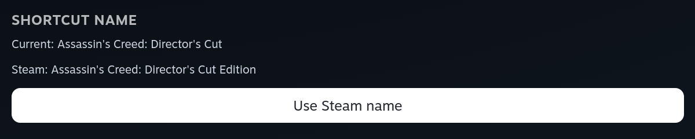

# Changelog

All notable changes to this project are documented here in Keep a Changelog form, and this project adheres to Semantic Versioning.

## [Unreleased]

### Added

- **Choose a HowLongToBeat game for Steam games.** When **Show HowLongToBeat
  times** is enabled, Steam games now show **Edit Metadata...** in their menu
  and open directly to the **HowLongToBeat** tab, so you can search for or pin
  the right HowLongToBeat entry when automatic matching misses (for example,
  *Gothic 1 - classic*). Per-game HLTB choices are stored separately from
  non-Steam metadata and apply only to Library game pages; Steam Store pages
  continue to use automatic matching.
- **Testing tab for pull request builds.** Under **Updates → Developer**,
  turn on **Enable Testing tab** to show a **Testing** tab in Settings. It lists
  open pull requests from this repository (plus fork pull requests opted in with
  the `test-build` label), lets you sort and open them on GitHub, and verifies
  the build published to the `pr-builds` GitHub prerelease against its manifest
  and SHA-256 checksum before handing the GitHub Releases ZIP to Decky Loader
  to install.

### Changed

- **SteamOS-style Updates UI.** **Settings → Updates** now matches SteamOS's
  **Software Updates** layout: a single **Software Updates** row shows the
  installed version and last-checked status with one morphing button (**Check For
  Updates** → **Checking...** → **Up-to-date** / **Apply** → **Applying...**),
  paired with an **Update Channel** dropdown (**Stable** / **Development**).
- **Focusable Metadata stats, grouped ProtonDB Game covers, and organized HLTB
  subsections.** In **Settings → Metadata**, **Detected non-Steam games**,
  **Metadata saved**, and **Missing metadata** are now selectable and focusable
  like **Versions**. In **Settings → ProtonDB badges**, **Game view** and
  **Store** sit directly below **Enable ProtonDB badges**, followed by a **Game
  covers** subsection for **Home game covers**, **Library game covers**,
  **Covers only on focus or hover**, and **Cover badge position** (the last two
  are enabled only when **Home game covers** or **Library game covers** is on).
  In **Settings → HLTB times**, controls below **Store** are now grouped into
  **Stats**, **Style**, **Customize**, and **Cache** subsections.

### Fixed

- **Keep Refresh metadata progress inside the Quick Access Menu.** The
  refresh progress bar now lays out below inside a `PanelSectionRow` with
  clamped wrapping so long game titles stay within the right edge of the panel.
- **Match Steam Store styling and fix first-pass loading for the Store info row.**
  HowLongToBeat numbers now use Steam Store blue, the ProtonDB tier label matches
  Steam Deck Compatibility's font and color, only the new **View details** button
  inside the ProtonDB card is focusable (matching Steam's **Learn more** button),
  and first-visit Store page navigation now observes nested DOM mounts and polls
  faster until attached.
- **Refresh Settings automatically when the plugin reloads.** Updating or
  installing a PR build from **Settings** now refreshes the open Settings page in
  place while keeping the active tab instead of leaving stale UI mounted.

## [0.6.7] - 2026-11-24

Add a full-screen Settings page and support the November 2026 Steam Beta

### Changed

- **Settings page replaces plugin settings in the Quick Access Menu.** Open
  Settings from the gear in the panel header. The full-screen page
  puts settings in side tabs, and changes apply at once. The Quick Access Menu
  now shows metadata counts, **Refresh metadata**, its progress bar, and
  **Install** only when an update is available. Each Settings
  tab follows Steam's own Settings layout: grouped sections with headings, and
  each action as a short button on the right of its label.

### Fixed

- **Works on the November 2026 Steam Beta.** On the new Steam Beta client,
  **Edit Metadata...** was missing from the game menu, matched non-Steam games
  showed the wrong quick links, and the Community tab did not show the matched
  game's content. All three work again on the Beta, and the Steam Stable client
  keeps working as before. The Beta needs a Decky Loader build that supports it.
- **Installed Version shows the version that runs, and Install stays
  available.** After you selected **Install**, the plugin showed the new version
  as installed and said **Up to date**, even when Decky Loader did not install
  it, for example after its confirmation window closed. This lasted until the
  plugin reloaded and for up to 15 minutes after that, and **Install** was
  hidden meanwhile. The plugin now always shows the running version and keeps
  offering the update until Decky Loader installs it. After a plugin reload
  with automatic checks off, select **Check now** to see the offer again.
- **Debug Logging switch works again.** In **Settings > Logs**, turning
  **Debug Logging** on or off had no effect. It now saves the setting and
  turns detailed logging on or off at once.
- **Metadata refresh stays visible.** A running **Refresh metadata** now keeps
  its progress bar in the Quick Access Menu, and **Clear cache** in Settings
  stays off until the refresh finishes. Before, the panel could forget the
  refresh, and clearing the cache during it let the refresh save old matches
  again. The scan that starts after **Clear cache** now shows its progress too.
- **Metadata counts show 0.** **Missing metadata** (and the other counts) showed
  nothing instead of **0**.
- **Quick Access Menu refresh looks and behaves like Steam.** The
  **Refresh metadata** progress bar now uses the full width of the panel, with
  the current game above it, in place of a narrow bar at the right. The result
  (games saved and not matched) now shows in the completion notification and
  no longer stays in the panel or on the Settings page. The three count rows
  can no longer be selected, and the controller now starts on the Settings
  button in the panel header, also on the first open after Steam starts.
- **Counts show sooner on the first Quick Access Menu open.** The plugin now
  loads the game list and counts when it starts, and asks for the two counts
  at the same time, so the first open after a restart does not wait for them.
- **Edit Metadata... fills its boxes sooner.** The editor no longer waits for
  the shortcut-name check before it shows a game's saved details. The **Shortcut
  Name** actions stay off until that game's own shortcut details have loaded,
  so switching games never offers the previous game's name.
- **Load timing in the debug log.** With **Debug Logging** on, each
  **Edit Metadata...** open writes one line with how long the saved details took
  to load and show. This helps find the cause when the editor is slow to fill.
- **Update status no longer sticks on "Checking".** Changing **Receive
  development releases** while a check was running, or pressing **Check now**
  while the new channel was still saving, could leave the status on "Checking"
  until the plugin reloaded. Checks now use the saved channel, and a stopped
  check always ends.
- **A failed install keeps the update offered.** When the installer failed,
  the update could disappear until the next check, or the error could be
  replaced by a check result. The status now says the installation failed, and
  **Install** stays available so you can try again. While an install runs,
  **Check now** and the update switches are off.
- **Quick setting changes no longer undo each other.** Turning two update
  switches, or both **Context menu** switches, in quick succession could put
  a switch back to a value that was never saved.
- **Debug Logging switch returns to its saved value when the save fails.** Before,
  it showed the unsaved value. **View logs** no longer opens the log window after
  you have left Settings.
- **Quick Access Menu looks and loads like other plugins.** Its rows have the
  standard Decky side padding again, and **Detected non-Steam games** no longer
  shows **0** for a few seconds each time you open the page.
- **Quick Access Menu opens fast with Debug Logging on.** A debug trace sent
  one log line for every Steam game in the library each time the menu opened,
  and the menu could take several seconds to show its counts. It now logs only
  the decisions that matter for matched shortcuts.

## [0.6.6] - 2026-11-22

Match Steam's own layout, colours and controls, and fix more Steam beta lookups

### Added

- **Game icon in the editor header.** A new **Context menu** section in the
  Quick Access Menu can show the game's icon beside its name at the top of
  **Edit Metadata...**, with long names scrolling as in Steam's own menu. A
  second option uses the matched Steam game's icon when the game has none;
  otherwise no icon is shown. Off by default.
- **Cover art in IGN results.** Each IGN search result in **Edit Metadata...**
  now shows the game's cover art when IGN has one.
- **Review before you apply.** Selecting a Steam or IGN search result on the
  **Game Match** page now opens a preview of the game details first. Long
  details scroll inside the preview. **Apply** puts the details in the editor;
  **Cancel** leaves the editor as it was. Nothing is saved until you select
  **Save**. Steam search results now stay listed when you visit another page
  of the editor and come back, as IGN results already did.

### Changed

- **Steam-style editor pages.** Help text now sits under the setting it
  explains, as in Steam's settings. Actions such as **Load from Steam**,
  **Use Steam name** and **Remove Metadata** are rows with a name, a short
  explanation and a button. Groups such as **Store Categories**, **Search
  Steam**, **Current match** and **Search IGN metadata** use Steam's section
  headings. Edited fields show **Edited** in colour without moving the label.
  HowLongToBeat results look like the Steam and IGN results. Steam and IGN
  search both show help under the search box, show result details on Steam's
  description line, and grey out their results while the editor is busy.
  The **Game Match** page now starts with the current match, shown as a row
  with the Steam game's art, name and App ID, followed by **Search Steam** and
  **Search IGN**. Typing a Steam App ID or URL moves behind **Enter ID...**.
- Editor text boxes stay white while you type with the on-screen keyboard
  and after you close it, until you move to another control. Steam's own
  boxes turn gray while the keyboard is open.
- **Quick Access Menu.** Help text sits under its control. Metadata scans
  show a progress bar, and the log viewer scrolls with the controller.
  Section headings keep their earlier look, with the blue highlight following
  controller focus.
- **Colours** follow Valve's Steam Deck palette.
- Controls that cannot do anything are disabled: editor fields for Steam
  games, update settings before they load, and trailer options while
  trailers are off.

### Fixed

- Trailers stop when you press **Play** in every Steam language.
- **Edit Metadata...** fills the screen down to the button bar, as Decky
  Loader's settings do, instead of stopping short and leaving a dark strip.
- Picking an IGN result no longer shows **Searching...**, an empty IGN search
  is blocked, and a failed search no longer says **Save failed**.
- On the Steam Deck Client Beta, game descriptions keep their line breaks,
  ProtonDB badges find Library covers without CSS Loader, and the HLTB
  **Details** button keeps Steam's style.
- Library compatibility icons on non-Steam games now use your device's own
  style, as Steam's icons do: Steam Machine and SteamOS icons instead of
  always the Steam Deck logo (#58). A Library compatibility filter picks its
  style too, and no icon appears where Steam shows none.
- On the Steam Deck Client Beta, compatibility icons appear again on Library
  Home and Library grid tiles for matched non-Steam games.

## [0.6.5] - 2026-11-20

New Steam-style metadata editor, Game Match, and Steam beta fixes

### Changed

- **Edit Metadata...** is in the Library card menu and in the game page's gear
  menu, for non-Steam games only. It appears near **Properties...**, next to
  SteamGridDB's **Change Artwork...** if that plugin is installed.
- **Steam-style editor.** The sidebar shows the game's name and six pages:
  **Details**, **Game Match**, **HowLongToBeat**, **Compatibility**,
  **Shortcut Name**, and **Advanced**. Move the D-pad to a page
  name to show it. Press **A** or **Right** to move into the page. Press **B**
  in a page to return to the sidebar; press **B** in the sidebar to leave. If
  you have unsaved changes, Steam asks you to **Save**, **Discard**, or
  **Cancel**. A blue dot marks each page with unsaved changes. **Save** stays
  at the bottom of the sidebar, and **X** also saves. The label shows the
  number of changes, as in **Save (3)**. Shortcut name actions take effect
  without **Save**. Each page has an icon and a heading spaced like Steam's
  own settings pages, and fields use Steam's own row
  layout. On **Details**, **Title**, **Developers**, and **Publishers** use
  full-width text boxes below their names, as in Steam's **Launch Options**.
  **Release Date** and **Rating** have their text box beside the name, as in
  Steam's **Custom Sort Name**. **Store Categories** is a section at the
  bottom of **Details**, and each category you change shows **Edited** until
  you select **Save**. If a future Steam update hides the
  sidebar, the editor says that this Steam version is not supported yet.
- **Load from Steam** is on **Game Match**. It fills the form and gives a
  reason when it is unavailable. Select **Load Steam text in** *your language*
  on the same page to load the description and genres in your Steam language.
  **Search IGN metadata** is also on **Game Match**, below **Steam App ID**.
  While one of these loads, only its own button shows that it is busy.
  Steam, IGN, and HowLongToBeat results are not stored until you select
  **Save**. **Refresh metadata** in the Quick Access Menu still finds and saves
  details for games without metadata.
- **Remove Metadata** is on **Advanced**. Confirm in **Remove Metadata?** to
  delete the saved details for that game. The **Metadata saved** and
  **Metadata removed** messages show the game's name.
- **Automatic compatibility.** The Quick Access Menu default now reads
  **Automatic**. The **Compatibility** page explains the difference between
  **Automatic**, **Use global default**, and **Follow Valve**.

### Fixed

- **Community tab on the Steam beta client.** Non-Steam games show their
  saved screenshots and the matched game's Community posts again on the Steam
  Deck Client Beta. The stable client was not affected.
- **Edit Metadata on the Steam beta client.** The editor opens again instead
  of showing an error screen, and the **Description** box uses Steam's
  on-screen keyboard.
- **Steam beta client support.** The **Edit Metadata...** menu row, the game
  page's Steam-styled rows, and other patched Steam parts keep working with
  the newer Steam Deck Client Beta, which renames Steam's internal parts.
  (#53, #56, #57)
- **Quick Access Menu focus.** Collapsible sections in the Quick Access Menu
  show the focus highlight reliably when you move with the D-pad. (#55)

## [0.6.4] - 2026-11-17

Add 25 plugin languages, editor Save and Done, and Push Play button down

### Added

- **Push Play button down.** A new **HLTB times** switch for the **Default**
  and **"Clean" Default** styles puts the times in their own row below the
  header image and moves the Play button down, like HLTB for Deck. While a Steam
  Cloud or SDH-Ludusavi save status bar shows at the bottom of the header image,
  the times stay on the image and Play does not move, so the bar keeps its
  artwork background. It is off by default. (#39)
- **Keep Play above the footer.** With **Push Play button down** on, a new
  **Keep Play above the footer** switch moves Play down only as far as the
  Play button still ends a few pixels above Big Picture's footer (Menu, Options,
  Select, Back). It follows footer sizes that themes such as Art Hero or Clean
  Gameview set. When there is no room, the times stay on the header image and
  Play does not move. It is on by default. (#48, #50)
- **Plugin text in 25 languages.** The panel, the metadata editor, messages,
  and the plugin's text on game and Store pages now follow your Steam language,
  in the same 25 languages as Decky Loader. Numbers, dates, and hours use your
  language's format. The non-English text is an unreviewed machine translation.
- **Steam details in your language.** For a non-Steam game matched to a Steam
  store page, Steam news follows your Steam language, and the description and
  genres follow it when the plugin gets the game's Steam details. Names,
  developers, publishers, and release dates stay in English. If you change your
  Steam language later, the editor shows **Fetch Steam text in** *your
  language*, which gets the description again; the plugin never replaces a description
  by itself. Steam gives English text when the store page has no text in your
  language. IGN details stay in English.
- **Save, Done, and a ⋯ menu in the metadata editor.** The editor's top row now
  has **Save**, which shows the number of changes, for example **Save (3)**, and
  is unavailable when nothing changed; **Done**; and a **⋯** menu with
  **Refresh from Steam** and **Remove metadata**. The controller **X** button
  also saves.
- **Change markers in the metadata editor.** A changed field is marked
  **Edited**, and Steam details loaded into the form but not saved yet are
  marked **From Steam, not saved**.

### Changed

- **Context menu label.** The game context menu entry is now **Change Metadata...**
  instead of **Decky metadata...**, to match Steam's other menu items. (#41)
- **Better French text.** The French text uses more natural wording, the "…"
  ellipsis, and **Boutique** for the Steam Store. The notice that another plugin
  controls HLTB times or ProtonDB badges now names the feature in a sentence form
  in every language.
- **Better translations.** A second machine review improved the wording in all
  24 non-English languages. The text now uses more of Steam's own words in each
  language, such as its names for Achievements, Home, and Play. No native
  speaker has reviewed it yet.
- **Less background work for game trailers.** With game trailers on, the plugin
  no longer checks Steam every 2 seconds when no trailer can play, and it checks
  less often while a trailer plays and nothing changes. (#44, #45)
- **One Steam debugger connection for trailers.** The plugin now keeps one
  connection to Steam's Big Picture page and uses it again for each trailer
  check, instead of opening and closing a new connection every time. This
  causes less connection churn for other tools that use Steam's debugger, such
  as CSS Loader. (#46)
- **The metadata editor uses a draft model.** Apply-style actions no longer
  save; they load details into the form, and **Save** stores them. **Use this
  Steam match**, **Apply Steam App ID**, an IGN search result, **Apply HLTB
  game**, the Steam text language button, and **Refresh from Steam** only fill
  the form. If you change the Steam App ID text without selecting **Apply Steam
  App ID**, **Save** asks you to apply it first.
- **Unsaved changes are confirmed.** Leaving the editor with **Done** or the
  controller **B** button while changes are unsaved asks **Save**, **Discard**,
  or **Cancel**. Leaving with the Steam or Home button does not ask, and the
  changes are lost.
- **Remove metadata asks first.** The editor now asks you to confirm before
  **Remove metadata** deletes the game's saved metadata.

### Fixed

- **Description field opens the on-screen keyboard again.** After a Steam
  client update, selecting **Description** in **Change Metadata...** and
  pressing A, or using Steam + X, no longer showed the keyboard. The other
  text fields were not affected. (#52)
- **SteamOS compatibility on other devices.** On SteamOS devices that are not
  a Steam Deck, such as the Lenovo Legion Go S, a matched non-Steam game's
  **SteamOS Compatibility** row showed Unknown. It now shows the matched game's
  SteamOS rating, or your chosen status (Verified and Playable show as
  Compatible, because SteamOS has no Verified level). Steam Machine and Steam
  Frame rows work the same way.
- **Removing metadata clears the compatibility badge.** **Remove metadata** now
  closes the editor and returns to the game page, where the game's Steam Deck
  compatibility badge in **Game Info** goes back to its original state.
  Before, pressing **Save** after removing saved an empty record, which brought
  the badge back. (#40)
- **Opening a news item works again.** For a non-Steam game matched to a Steam
  store page, selecting a news item in **Activity** now opens it. Before, Steam
  showed "An error occurred while rendering this content" instead.
- **IGN search starts fresh for each game.** When you went from one game's
  metadata editor straight to another game's editor, **Search IGN metadata**
  still showed the first game's search text and results. It now starts with the
  current game's name and no results. (#43)
- **Header image no longer jumps with game trailers.** On a game page with a
  Steam Cloud save status bar, the header image grew about a second after the
  page opened, which made it zoom and move. This happened only when SDH-Ludusavi
  was off. The image now gets its final size before the page fades in, also on
  a Steam Deck. (#47)
- **Panel switches no longer flash.** Changing a switch in **HLTB times** or
  **ProtonDB badges** briefly dimmed every control in the section while the
  setting was saved. The controls now stay as they are, and two quick changes
  in a row are both saved. (#49)
- **Invalid Steam App ID text no longer clears the match.** Text that is not a
  valid Steam App ID or a Steam or SteamDB URL now shows a warning and changes
  nothing. Before, it cleared the saved match.
- **An HLTB number no longer carries over between games.** An HLTB number typed
  for one game could appear when another game was opened in the same editor. The
  field now starts from the current game.
- **An HLTB number typed during a save is kept.** A number typed while a save
  was running could be lost; it is now kept.

## [0.6.3] - 2026-11-13

Fix game page freezes with Unifideck 0.8.0 and add a Store info row with HowLongToBeat and ProtonDB

### Added

- **Store info row.** Steam Store game pages now show a boxed info row directly
  below the trailers and screenshots, in the style of Steam's own **Reviews**
  and SteamOS Compatibility rows. It holds a **HowLongToBeat** box with the same
  times as the game page, honoring the stat switches, and a **ProtonDB** box
  with the game's tier. Selecting a box opens that game on HowLongToBeat or
  ProtonDB. The row works for games you do not own, and you can select the boxes
  with the D-pad.
- **HLTB Store switch.** The new **Store** switch in **HLTB times** controls the
  **HowLongToBeat** box on Store pages. It is on by default.

### Changed

- **ProtonDB Store switch controls the Store box.** The ProtonDB **Store**
  switch now turns the **ProtonDB** box in the info row on or off. If only one
  box has data, it fills the row. If both switches are off, there is no row.
- **Mini achievements for non-Steam games.** When another plugin, such as
  Emuchievements, gives Steam the achievements for a non-Steam game, its
  ACHIEVEMENTS row now shows beside Play Time, as it does for Steam games.
  Non-Steam games without achievements still get no row.

### Removed

- **Floating ProtonDB Store badge.** The colored ProtonDB icon at the bottom
  right of Steam Store pages is gone. The **ProtonDB** box in the info row
  replaces it.

### Fixed

- **Game page freeze with Unifideck 0.8.0.** Opening a Unifideck game's page
  no longer freezes Steam on a spinning logo when Decky Metadata and Unifideck
  have a different Steam Deck compatibility rating for it. Decky Metadata's
  rating is shown, and Unifideck's other game details stay in place.
  ([#35](https://github.com/beallio/Decky-Metadata/issues/35))

## [0.6.2] - 2026-11-13

Mini achievements and Activity news work again after Steam's November update

### Changed

- **HLTB "Details" button.** The button that opens a game's HowLongToBeat page
  is now called **Details**. In the **Default** style it looks like the
  **Details** button in Steam's Deck Compatibility section. In the **"Clean"**
  styles it looks like the ProtonDB and controller buttons beside Play, and it
  follows the corner rounding of the CSS Loader theme "Round". The **"View
  Details" color** option is removed.
- **HLTB "Clean" bars match the Play bar.** In the Clean Gameview
  **Transparent**, **Blur**, and **Connected with Body** Play bar styles, the
  HLTB row always uses the Play bar's background. The new **Background blur**
  option matches the Play bar by default and can also force or remove the blur.
  **Background opacity** now applies to the **Default** style only.
- **"Clean" HLTB Details corners.** The new **Use Steam button corners** option
  keeps the **Details** button corners as Steam draws them, so the "Round" theme
  does not round them. It is off by default.

### Removed

- **Show/Hide HLTB Stats in the game menu.** The entry is removed. Games you
  hid this way show their times again. To hide all times, turn off **Show
  HowLongToBeat times**.

### Fixed

- **HLTB background and blur.** The "Clean" bars match the Play bar's
  background and opacity. When the Play bar is blurred, the **"Clean" Default**
  times and the Play bar now share one seamless blurred panel. **Background
  blur** never changes the Play bar's blur.
- **HLTB times no longer push the Play button down.** The **Default** and
  **"Clean" Default** rows now sit on the bottom of the game's header image, so
  the Play row stays in its usual place.
- **Mini achievements works again after Steam's November client update.**
  Steam's update hid its own mini achievements row on the Steam Deck game page.
  Metadata now turns Steam's own row back on, so it looks and behaves exactly
  like Steam's, and selecting it opens My Achievements. Games without Steam
  achievements get no row.
- **Activity news shows again for matched non-Steam games.** Steam's new
  activity cards need fields the plugin did not supply, which made the page
  show a render error instead of the news.
- **Debug logging follows Decky Loader's debug switch.** Turning on debug
  logging for Decky Metadata in Decky Loader now records debug messages, even
  when the plugin's own **Debug logging** setting is off.

## [0.6.1] - 2026-11-02

HowLongToBeat times on game pages, and ProtonDB badges right after a restart

### Added

- **HowLongToBeat times.** Turn on **HLTB times** to see how long players take
  to finish a game, on the game's page, for Steam and non-Steam games. Steam
  games are matched by their Steam App ID, so a remaster or remake is not
  confused with the original. You can search HowLongToBeat and choose the game
  for a non-Steam game in its editor, and hide the times for one game from its
  menu.
  It is off by default and cannot be turned on while HLTB for Deck is enabled.

### Changed

- **ProtonDB badges appear right after a restart.** Ratings are now saved, so
  badges show at once after Steam or the Deck restarts. Ratings older than a
  day still refresh in the background.

### Fixed

- Screenshots for games matched through IGN now appear the first time you open
  the game. Before, a background news check could stop them from loading until
  your next visit.

### Security

- Updated a development-only URI library to fix four security advisories.
  The affected library is used by the build tools, not the installed plugin.

## [0.6.0] - 2026-10-25

Faster plugin, Steam match picker, and removed metadata stays removed

### Added

- **Pick a Steam match in the editor.** In a game's editor, search Steam and
  compare the results by artwork, developer, and release date. Select **Use
  this Steam match** to save one. Looking at results or selecting Cancel
  changes nothing, and Cancel returns you to the result you had selected.
- You can still type a Steam App ID or paste a Steam page link, and IGN search
  is still there. Choosing a Steam match does not rename the shortcut or
  replace your custom artwork.

### Changed

- **Faster plugin.** The part of the plugin that runs in the background was
  rewritten. Saving a game's details is much faster, also with large
  libraries. It works with the standard Decky Loader and with the beallio
  Loader fork. Your saved details, settings, and shortcut-name history stay in
  place.
- The plugin loads less data when it starts and when you open the Quick Access
  panel. A game's Steam news now loads when you open that game.
- Each game's details are now kept in their own file, in a `metadata` folder
  next to the settings file. The first start after the update moves your
  existing details there.
- **Going back to an older version:** use the plugin's built-in updater. It
  first copies your details back into the single settings file, so the older
  version still finds them. An older version that you install by hand from a
  ZIP file does not show your saved details.
- On the standard Decky Loader, the plugin gives back memory it used for large
  data transfers when it is idle.
- Updated the tools used to build and test the plugin, to fix reported security
  problems. These tools are not part of the installed plugin.

### Fixed

- **Removed metadata stays removed.** After **Remove metadata**, the plugin no
  longer matches that game again by itself. Before, the background news update
  could match the game's name to a Steam game about 15 minutes later, and the
  news came back. Opening the game no longer fetches IGN details for it, and
  **Refresh metadata** skips it. To match the game again, pick a Steam match or
  an IGN result in its editor, or use **Clear cache**. If you removed a game's
  metadata before this update, remove it once more after you update. Fix for
  [issue #3](https://github.com/beallio/Decky-Metadata/issues/3).
- If a game's news cannot load, its Activity tab keeps what it already showed.
- When you choose a different Steam match, the new store link and Steam name
  are kept.
- If the plugin cannot read its settings file, it no longer saves over that
  file, so your saved details are not lost.
- Screenshots that finish loading late no longer overwrite changes you made in
  the meantime.
- **View logs** now works even if the log file could not be set up when the
  plugin started.

## [0.5.4] - 2026-10-11

Add Home trailer previews and separate controls for each view

### Added

- Added muted trailer previews behind the selected game on Home. Home previews
  stay off until you enable them. Existing game-page trailer choices stay in place.
- Added hourly checks for game-data and plugin-update services. Repeated failures
  open one issue with error details; a successful check closes it. Manual checks
  do not change issues or failure counts.

### Changed

- Added separate Home and Detail switches and fade-in delays under one main
  trailer switch. Video quality remains shared.
- Grouped the trailer controls under larger, plain Detail view and Home view
  headings. The groups do not have separate expand or collapse actions.

## [0.5.3] - 2026-10-10

Fix game page freezes with Unifideck

### Fixed

- Fixed an issue where Steam game pages froze when Decky Metadata and Unifideck were used together. Fixes [#19](https://github.com/beallio/Decky-Metadata/issues/19).
- Metadata edits and refreshes continue to work, with or without Unifideck.

## [0.5.2] - 2026-10-09

Fix non-Steam cover flicker

### Fixed

- Non-Steam game covers no longer briefly show a broken-image icon when returning from a game page. Custom artwork and Game Info keep working. Fixes [#29](https://github.com/beallio/Decky-Metadata/issues/29), reported in [#18](https://github.com/beallio/Decky-Metadata/issues/18).

## [0.5.1] - 2026-10-07

Fix game descriptions, release dates, and duplicate Verified badges

### Fixed

- Game descriptions now use the source's short summary when available instead of page text and advertisements. Paragraphs and lists remain readable, and your custom descriptions are preserved.
- Steam imports now support both English release-date formats, fixing missing dates. For example, Dave the Diver now imports its full Steam release date of June 28, 2023.
- Dates saved in the editor no longer display one day early, and changing time zones does not shift the date. Clearing a date removes it from Game Info.
- Quickly leaving a game page no longer displays a duplicate Verified badge on its Library cover. Cached covers may require one Steam restart after updating to correct the display.
- Turning off trailers now stops background checks and restores the game artwork. Other causes of slow scrolling on the Home screen are still being investigated.

### Security

- Updated source-map-js to version 1.2.2 to resolve a security vulnerability in a development dependency.

### After updating

After updating, open Decky Metadata, go to Metadata, and select Clear cache under Metadata cache. This deletes all saved metadata, matches, and manual edits, and begins a new scan. Back up any changes you wish to keep before clearing the cache. Wait for the scan to complete. You can select Refresh metadata in the same section to scan again if needed.

Manual IGN imports still use IGN's listed date. For Dave the Diver, IGN lists its early-access date of October 27, 2022; selecting full-release dates from IGN is not included in this update.

## [0.5.0] - 2026-10-03

Add ProtonDB badges, mini achievements, and collapsible settings

### Added

- **ProtonDB badges.** Optional community ratings on Home and Library covers,
  game pages, and Steam Store pages. Each view has its own switch, with cover
  position and focus/hover controls. Select a game-page or Store badge to open
  its reports. Ratings are shared across views and cached for 24 hours; games
  without a match or tier stay hidden, and lookup errors are not Borked ratings.
- **Mini achievements.** A default-off setting restores Steam's small
  achievement progress bar beside Play Time. It uses Steam's own data and
  does not add achievement tracking to non-Steam games.
- **Collapsible Quick Access Menu sections.** Select a heading or press A to
  show its controls. Versions starts open; other sections start closed.
  Background update checks continue while Updates is closed.
- **Known plugin conflict guards.** Metadata pauses badges while ProtonDB
  Badges is active, trailers while TrailerHero is active, and mini achievements
  while Decky UI Restored is active. The panel names the peer. Detection checks
  plugin activity, not the peer's individual settings. Saved choices resume
  when the conflict clears unless you turn our switch off while paused.
  Residual TrailerHero players also prevent duplicate trailer playback.

### Changed

- Quick Access Menu headings have larger text and icons. Compatibility choices,
  version values, and help text are easier to read.
- Metadata cache and Delisted Steam games are grouped inside Metadata.
  Game counts no longer take controller focus.
- Sections no longer draw a divider after their final control; internal
  dividers and spacing make the tool groups clearer.
- The README gives a short product tour. Detailed help covers ProtonDB
  controls, matching, mini achievements, and plugin conflict behavior.

### Fixed

- Section headings stay in view when D-pad focus reaches them below expanded
  controls or long help notes. Dropdown cancellation and return preserve focus.
- Trailers keep a stable height when a game page opens or closes with a visible
  save-status bar, including after a theme is turned off and on. Taller
  full-width bars get more trailer space; hidden, compact, or moved indicators
  do not add extra space. Steam's normal page animation still plays.
- ProtonDB badges stay with their native covers and controls during page
  animations and remain available on Library tabs, including Non-Steam.
- Non-Steam badges prefer a valid saved Metadata Steam App ID, then a title
  lookup. Correcting or clearing the match updates visible badges without
  retaining the previous game's rating.
- Project skill installation checks the destination repository correctly when
  invoked from a Git hook, without bypassing external-worktree protection.

## [0.4.0] - 2026-09-28

Add opt-in game trailer streaming with Steam-first playback and an IGN fallback.

### Added

- **Game trailers.** Enable game trailers in the Quick Access Menu. Existing
  installs stay disabled until you opt in. Steam movies take priority; when
  Steam has no playable movie, a clearly matched IGN game trailer can play.
  Non-Steam shortcuts can use IGN even without a saved Steam match. The
  original hero stays visible until a playable trailer is ready and remains
  in place when neither source has a suitable movie. Set audio and Auto,
  720p, 1080p, 1440p, or 2160p quality in the new section. Trailers stream;
  they are not saved offline. Uninstall the separate TrailerHero Decky plugin
  before enabling this feature.
- **Trailer fade-in delay.** Set the wait before a ready trailer replaces the
  artwork from 0 to 10 seconds. Existing installs keep the three-second default.
- **Optional trailer logo.** A new setting hides the game logo only while a
  trailer is visible. It is off by default and restores the logo when playback
  stops, fails, or the game page changes.
- **Expanded trailer view.** Press Y while a trailer is visible to hide the
  game page controls and enlarge the video without restarting it. Press Y or B
  to return. Steam's footer shows the action, and the page returns when
  playback stops or you leave the game.
- **IGN trailer health.** An hourly check alerts maintainers with one open
  issue if game lookup, trailer selection, or MP4 delivery stops working.

### Fixed

- Trailer audio now stays silent behind the hero artwork and fades in with the
  video when it appears, instead of playing before the video is visible.
- Artwork and trailers now show through transparent save-status bars on game
  pages. The bar stays in place, and the artwork returns to its usual size
  when the bar is gone.
- Game trailer quality changes now return D-pad focus after the Steam menu
  closes, including while a trailer is playing. Trailers paused during SteamOS
  sleep resume in place, even when sleep interrupts the initial artwork delay.
  If playback cannot resume, Metadata restores the original artwork without
  repeated retries.
- The trailer audio X hint appears when Steam's footer loads after playback
  starts and returns if Steam redraws the footer.
- Non-Steam games with saved metadata now load their running-game Steam Menu
  icon even when Game Info requests it before Steam has cached the image. Closes
  [issue #15](https://github.com/beallio/Decky-Metadata/issues/15).

## [0.3.14] - 2026-09-20

Add configurable compatibility defaults for non-Steam games

### Added

- **Library-wide compatibility defaults.** Choose Automatic, Verified,
  Playable, Unsupported, or Unknown in the Decky Metadata panel. The setting
  applies to existing and new non-Steam shortcuts, including ones without
  saved metadata. Other shortcuts update immediately; the current Game Info
  game updates after its tab exits. Per-game choices now include **Use global
  default** and **Follow Valve**. Fixes [issue #12](https://github.com/beallio/Decky-Metadata/issues/12).
- **Compatibility default scopes.** The **Apply default to** dropdown selects
  Steam-matched games, saved games without a Steam ID, all saved metadata, or
  all native non-Steam games. It uses the saved record and valid Steam ID, so
  manual records are in the no-ID scope and a provider name does not decide
  eligibility. The saved selection stays available after Automatic is chosen.

### Fixed

- Place the compatibility scope separator below its explanation, directly above
  **Refresh metadata**.

### Security

- Update test and CI tooling so mock redirects stay inside allowed file-system
  paths, uv downloads use verified checksums, and installs use safer defaults.

## [0.3.13] - 2026-09-07

Add Steam shortcut names and fix stale Activity news

### Added

- **Use Steam's name for a non-Steam shortcut.** The per-game **Decky metadata...** editor shows the current shortcut name beside the official Steam name for its saved match. Select **Use Steam name** to preview and confirm the change. Names never change automatically.
- **Restore the original shortcut name.** After a confirmed rename, use **Restore original name** to return to the saved original. If another tool changes the name, the editor reports the conflict instead of overwriting it.

### Fixed

- **Activity news clears when metadata is removed.** **Remove metadata → Save → Done** now removes that shortcut's injected news without a SteamUI reload or plugin uninstall. Other games' Activity remains unchanged. Fix for [issue #3](https://github.com/beallio/Decky-Metadata/issues/3).
- **Controller access to shortcut names.** The name/status section is selectable with the D-pad even when no rename action is available. It scrolls fully into view and uses the editor's background with an outline for controller focus.
- **Steam title matching.** Page-title matching now ignores trademark, registered, and copyright marks consistently, so those symbols do not prevent a saved match from being recognized.

### Shortcut-name controls

## [0.3.12] - 2026-09-04

Fix stable installs from local builds and marker-word title matching

### Fixed

- A local `X.Y.Z+<hash>` build now recognizes and can install the canonical stable `X.Y.Z` release, while development prereleases remain manual-only.
- Games whose titles are made up of words like `Prototype` or `Test` now match their Steam store entry, so they receive Steam details, news, compatibility, and quick links.

## [0.3.11] - 2026-09-01

Compatibility badges remain visible after plugin or SteamUI reload without selecting each game.

### Fixed

- Non-Steam Playable, Verified, and Unsupported badges now refresh on already-mounted Library Home and grid cards after a plugin or SteamUI reload.
- Home compatibility badges now recover when cards mount after a Steam JavaScript-context restart.

## [0.3.10] - 2026-08-30

Compatibility badges now load automatically

### Fixed

- Non-Steam compatibility badges now appear as soon as saved metadata loads and remain correct after plugin or SteamUI reloads; selecting each game is no longer required.

## [0.3.9] - 2026-08-28

Set the compatibility status for non-Steam games

### Added

- The **Decky metadata...** editor now lets you choose Automatic, Verified,
  Playable, Unsupported, or Unknown for non-Steam games.

## [0.3.8] - 2026-08-27

SteamGridDB artwork now works with matched non-Steam games

### Fixed

- Matched non-Steam shortcuts now keep their SteamGridDB artwork and Library Home icons while Decky Metadata enriches Game Info pages ([#5](https://github.com/beallio/Decky-Metadata/issues/5)).

## [0.3.7] - 2026-08-27

Community controller layouts now work correctly on Legion Go S

### Fixed

- Matched non-Steam games on Legion Go S now show compatible Community layouts instead of appearing empty, while Steam's normal visible controller filter remains intact.
- Choosing Show All Layouts now keeps you on the controller-layout tab you were viewing instead of jumping back to Your Layouts.

### Added

- The Quick Access Menu Versions panel now shows the connected controller type, making device-specific layout behavior easier to understand and troubleshoot.

## [0.3.6] - 2026-08-07

Controller Settings → Search now shows only the layouts belonging to the game you are configuring.

### Fixed

- Controller Settings → Search on a non-Steam game lists that game's layouts and
  its matched Steam game's layouts, and nothing else. Previously the layouts of
  any other game whose Controller Settings you had opened during the session —
  including ordinary Steam games — kept appearing on every game you visited
  afterwards.
- Controller Settings → Search on a regular Steam game no longer lists layouts
  belonging to your non-Steam games. Steam's own cross-game search results for
  Steam titles are unchanged.
- The Search filter now takes the app being configured from Steam's controller
  configurator rather than inferring it from the previous request, so it can no
  longer act on a stale game after switching pages.

## [0.3.5] - 2026-07-25

Maintenance release: CI build-toolchain action updates.

- No on-device/plugin behavior changes in this release.

### Changed

- CI: the quality-gates workflow now uses `actions/setup-python@v7` and
  `astral-sh/setup-uv@v9.0.0`. Both actions run only on the build runner and
  are never part of the packaged plugin, so installed plugins are unaffected.

## [0.3.4] - 2026-07-24

Maintenance release: store listing image and build-toolchain dependency patches.

- No on-device/plugin behavior changes in this release.

### Changed

- The plugin's store listing image no longer points at the plugin template's
  placeholder, which rendered a GitHub repository card for an unrelated
  project. It now shows Decky Metadata's own Steam Community controller
  layouts screenshot.

### Security

- Patched four high-severity advisories in transitive build dependencies
  (`brace-expansion`, `fast-uri`), plus `postcss`, via a lockfile-only update.
  All are devDependencies of the rollup/vitest toolchain and are never part of
  the packaged plugin, so no installed plugin was ever exposed.

## [0.3.3] - 2026-07-21

Bug fixes for the library context menu and the metadata editor's description field.

### Fixed

- Library context menu: opening "Decky metadata..." for one non-Steam game and
  then another no longer shows the first game's metadata for every subsequent
  game; each entry now opens the game whose menu is actually open.
- Metadata editor: the multiline Description field now accepts on-screen
  keyboard input on the Deck. It previously took focus but could not be typed
  into, because Steam only routes the virtual keyboard to its own field
  components; the editor now uses Steam's gamepad-aware text area.

## [0.3.2] - 2026-07-18

Maintenance release: release-notes tooling and CI hardening.

- No on-device/plugin behavior changes in this release.
- Release-notes gate: every stable and dev release now requires curated,
  dated `CHANGELOG.md` notes, enforced by `scripts/changelog.py` in CI and
  `scripts/release.sh`, with the release title drawn from the section summary.
- Deterministic `scripts/changelog.py rollover` command for cutting a version.
- New `decky-release-notes` maintainer skill that drafts the notes and performs
  an authorized local release cut; installer now selects among project skills.
- CI: added Dependabot for GitHub Actions and moved maintained actions off Node 20.
- Docs: on-device install / self-update runbook; plugin description now mentions
  Steam community controller layouts.

## [0.3.1] - 2026-07-17

Added trusted self-update discovery, installation handoff, and QAM controls.

## [0.3.0] - 2026-07-17

Refined the editor and QAM while adding stable and development release tooling.

## [0.2.0] - 2026-07-14

Added matched-game controller layouts with isolated Steam search state.

## [0.1.0] - 2026-07-13

Established the SteamOS-native metadata, diagnostics, and packaging foundation.
